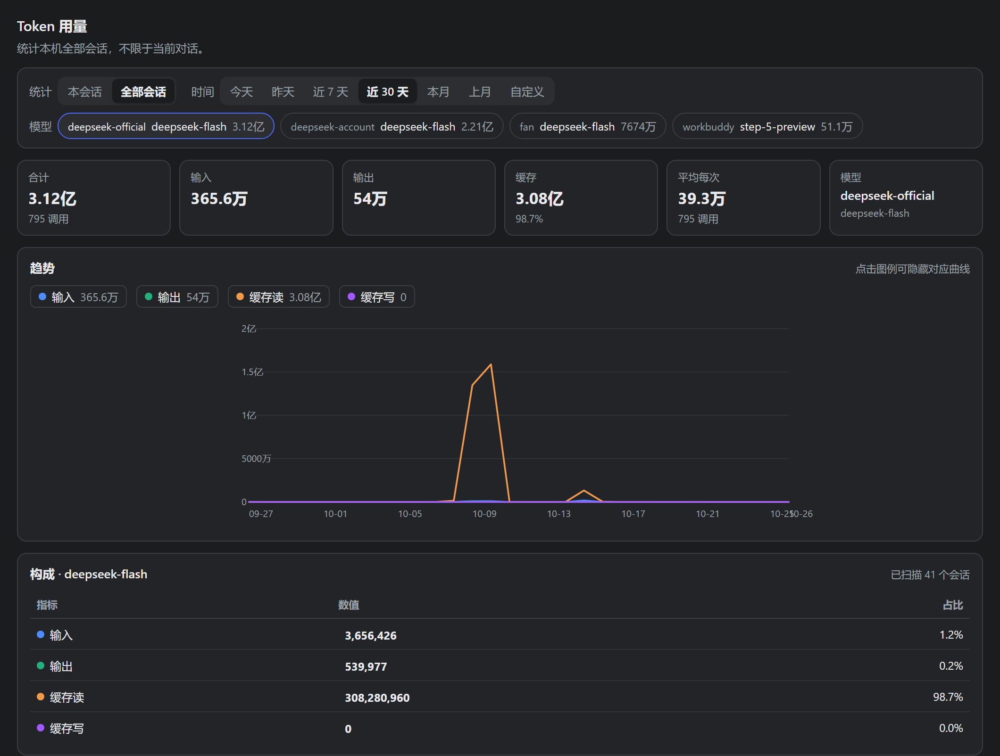

# dsh-token-usage

[](https://github.com/deepseek-ai/deepseek-harness)

DSH Web UI 的 Token 用量看板，作为 Conversation View 的一个标签页，排在「对话」「轨迹」之后。



- 只统计 token 数量，**不做费用估算**。
- **一张折线图**同时画四条线：输入、输出、缓存读、缓存写。
- 只有两个维度：**时间** 与 **模型**，两者都放在顶部工具栏里。
- 时间：今天 / 昨天 / 近 7 天 / 近 30 天 / 本月 / 上月 / 自定义（上限 365 天）。
- 模型：从数据里自动归纳出有哪些模型，**一次只显示一个**。
- 图例在图表**上方**，点击可隐藏对应曲线；图例上直接标出该模型在这个窗口内的合计。
- 数字单位跟随界面语言：中文用 **万 / 亿**（如 `3.12亿`），英文用 K / M / B。
  悬停卡片可以看到精确到个位的原始数字。
- 粒度跟着时间范围走，不单独设控件：今天 / 昨天按小时，更长的范围按天。

## 为什么是这两条维度

时间与模型是这份数据里**唯一两个正交的切分方向**：token 消耗的形状是「哪个模型、在什么时候、用了多少」。
再往里加维度（会话、工作区、事件类型）只会让一张图变得读不懂，而它们都能用「本会话 / 全部会话」这一个开关覆盖住。

模型是单选而不是「全部显示」：不同模型的流量量级差得很远（批处理模型一次几十万 token，
聊天模型一次几千），画在同一根 y 轴上，小的那条会被压成贴地的直线。单选才能让每条曲线都用满画布高度。

四条曲线之所以放在同一张图而不是拆成四张小图，是因为它们共享同一个 y 轴量纲：把输入和缓存读画在同一个坐标系里，
才能直接看出「这一次请求里，有多少是真正新算的、有多少是命中缓存的」。

## 安装

需要 DSH 桌面版或 Web 版。

```
plugin_manager install_bundle  target=<这个目录的绝对路径>
```

然后确认目标 profile 的 `package.json` 里 `dsh.profile.bundles` 包含 `dsh-token-usage`。
装到 `desktop` profile 才会在桌面 GUI 生效；重启或刷新后，「轨迹」右侧会出现「Token 用量」标签页。

从源码目录直接开发时，用 `link:` 依赖挂进 profile 即可热更新：

```json
{ "dependencies": { "dsh-token-usage": "link:D:/dsh-token-usage" } }
```

## 数据来源

Host 端通过官方 `ctx.sessionQuery` 服务读取会话语料，只取 `assistant/message` 事件里的
`data.usage`，并从同一条记录的 `data.message.source` 取出 `provider` 与 `model`。

用 `sessionQuery` 而不是自己解压 `session.jsonl.zstd`，有两个明确原因：

1. 一个会话目录下可能同时存在 `session.jsonl.zstd`、`session.v3.jsonl.zstd`、
   `session.v4.jsonl.zstd` 三个版本文件。直接读目录会把同一批响应重复统计两到三次。
2. `readSession` 会返回逻辑日志和 `inheritedEventCount`。子代理 / fork 会话在自己日志里
   会重放父会话的前缀，只有该偏移之后的事件才是它自己的用量，否则父子会双重计数。

「本会话」范围会按会话谱系向下合并派生会话（子代理 / fork），与界面上的说明一致。

## 聚合方式

读取会话日志是唯一的重开销步骤，因此 Host 端把扁平记录缓存 60 秒；切换时间范围、切换模型
都只在内存里重新分桶，不再读日志。空时段补 0，折线不会跨过真实的数据空档画出一条假直线。

**点数保护**：客户端在一天以内的窗口按小时取、更长的按天取，最坏情况也就 366 个点。
Host 侧另有一层兜底：手写请求若指定了与窗口不匹配的粒度（例如一年跨度要小时），
会自动降级到天或月，任何请求都不会产生上千个点。自定义范围上限 365 天。

## HTTP 接口

```
GET /_dsh/dsh-token-usage/usage
    ?from=EPOCH_MS     窗口起点
    &to=EPOCH_MS       窗口终点
    &bucket=hour|day|month
    &tzOffset=MINUTES  东为正，按查看者本地墙钟分桶
    &sessionId=ID      可选，限定该会话及其派生会话
    &refresh=1         可选，绕过记录缓存
```

「今天 / 昨天 / 本月 / 上月」是**日历边界**，由客户端按查看者本地时间算成 epoch 再传。
Host 不做日历推断，这样时区与夏令时都不会猜错。

旧参数 `days=N` 仍然接受，向后兼容。

响应要点：`buckets[]`（每个时段含 `series[]`，元素是
`[模型序号, 输入, 输出, 缓存读, 缓存写, 调用数]`，字符串只在 `combos[]` 里出现一次，
所以切换模型不需要再发请求）、`combos[]`（自动归纳出的模型清单，按用量降序）、
`totals`、`scan`（扫描了多少会话、失败多少）。

## 开发

```
npm run check   # node --check 两个半区
npm test        # 27 个测试：Host 聚合正确性 + Client 渲染与交互
```

测试不依赖浏览器：`test/harness.cjs` 是一个只够用的 hooks 运行时，
Client 测试把 `fetch` 直接接到真实的 Host 处理器上，所以跑的是真实的请求/响应契约。

```
npm run screenshot          # 用真实组件 + 真实数据重新生成 docs/screenshot.png
npm run verify:screenshot   # 断言截图里四条曲线都在（防止截出一张空图）
```

截图不是手工画的示意稿：`docs/make-screenshot.cjs` 用测试 harness 渲染真实的
Client 组件、喂进真实 Host 从本机会话算出的 payload，序列化成静态 HTML 后再用
无头 Chrome 截屏，并按实际内容高度自适应窗口大小。`docs/preview.html` 是中间产物，
已在 `.gitignore` 里。

## 许可

[MIT](LICENSE)